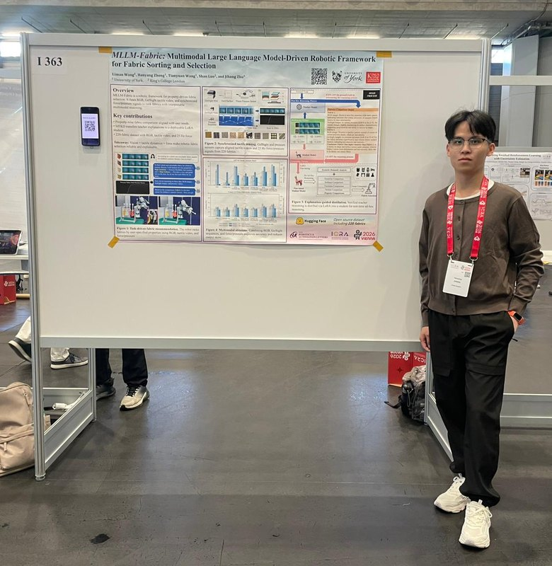

  

    <h1>Hanyang Zhong (钟翰扬)</h1>
    

      PhD candidate in Electronic Engineering (Robotics) at the
      <a href="https://www.york.ac.uk/">University of York</a>, UK (expected Jan 2027).
      I build complete real-robot systems for <strong>dexterous, contact-rich manipulation</strong>:
      dexterous hands and fingertip force sensors, embedded control, multimodal data collection,
      and imitation-learning policies deployed on physical robots. I also build
      <strong>agentic robots</strong> that use LLM/MLLM reasoning to drive learned skills.
    

    

      <a href="mailto:hanyangzhong552@gmail.com">Email</a>
      <a href="https://scholar.google.com/citations?user=6cbhsRMAAAAJ">Google Scholar</a>
      <a href="https://github.com/HanyangZhong">GitHub</a>
      <a href="https://huggingface.co/hanyang1">Hugging Face</a>
    

  

  

    
    
Presenting our <a href="https://ieeexplore.ieee.org/abstract/document/11217170">MLLM-Fabric</a> poster at ICRA 2026, Vienna

  

  <strong>Open to roles from early 2027:</strong> Robotics / Embodied AI Research Scientist,
  Robot Learning Engineer, or Postdoc, in dexterous manipulation, robot learning and embodied AI.

<section>
  <h2>Highlights</h2>
  <ul class="highlights">
    <li><strong>Co-first author of <a href="https://dexremo.github.io/">DexRemo</a>, accepted to IEEE T-RO (2026).</strong>
      Designed the hardware and fingertip force sensors for a low-cost, 12-DoF three-finger hand.
      Adding fingertip force raised imitation-learning success from <strong>24% to 83%</strong>,
      and the hand reached a <strong>62.5 N</strong> pull-out strength, the highest among the hands we compared.</li>
    <li><strong>5 peer-reviewed papers</strong> in T-RO, RA-L, ICME (Oral), ICMEW and CogSci; first or co-first author on 4.</li>
    <li><strong>Built a full robot stack alone:</strong> the bimanual teleoperation platform, force sensors, PCB and firmware,
      the data pipeline, and policy deployment. Independent first author of a bimanual imitation-learning paper under review at ICRA 2027.</li>
    <li><strong>Reviewer</strong> for ICRA, RSS, CoRL and IROS. Presented a poster at ICRA 2026 in Vienna.</li>
    <li><strong>Open-source releases:</strong> the <a href="https://huggingface.co/datasets/EuniceF/MLLM-Fabric">MLLM-Fabric dataset</a>,
      the <a href="https://github.com/HanyangZhong/BRU-datasets">BRU dataset</a> and <a href="https://github.com/HanyangZhong/FENet">FENet code</a>.</li>
    <li><strong>Industry experience:</strong> 2 years as an Embedded Systems Engineer and 3 years as a Graduate Teaching Assistant for MSc Intelligent Robotics.</li>
  </ul>
</section>

<section>
  <h2>Tech Stack</h2>
  

    
Robot Learning

    
Imitation LearningACT-style PoliciesTeleoperation Data CollectionMultimodal Policies (Vision / Force / Tactile)Real-Robot Deployment

  

  

    
Embodied AI

    
LLM / MLLM Task PlanningAgentic Skill OrchestrationVLA SystemsMLLM Fine-tuning

  

  

    
Software

    
PythonC++PyTorchROSOpenCVLinuxGitMulti-sensor Sync &amp; Logging

  

  

    
Hardware

    
Fingertip Force / F-T SensingSensor CalibrationPCB DesignEmbedded FirmwareMotor Control

  

  

    
Mechanical

    
SolidWorksInventorDexterous Hand Prototyping3D PrintingCNCSheet Metal

  

</section>

<section>
  <h2>Selected Publications</h2>

  

    
NewDexRemo: A Force-Sensing Hand Platform and Task Suite for Contact-Rich Removal Manipulation

    
Liman Wang&dagger;, <strong>Hanyang Zhong</strong>&dagger;, Zhaole Sun, Wenting Cao, Babar Jamil, Andy Tyrrell, Shan Luo, Jihong Zhu
      (&dagger;equal contribution)

    
<em>IEEE Transactions on Robotics (T-RO), 2026, accepted</em>

    

      <a href="https://dexremo.github.io/">Project Page</a>
      <a href="https://arxiv.org/abs/2611.15981">Paper</a>
      <a href="https://youtu.be/4ot1Yy7es_o">Video</a>
    

  

  

    
Under ReviewHidden Force-Regime Coverage for Contact-Rich Bimanual Imitation Learning

    
<strong>Hanyang Zhong</strong>, et al.

    
<em>IEEE International Conference on Robotics and Automation (ICRA), 2027, under review</em>

  

  

    
MLLM-Fabric: Multimodal Large Language Model-Driven Robotic Framework for Fabric Sorting and Selection

    
Liman Wang, <strong>Hanyang Zhong</strong>, Tianyuan Wang, Shan Luo, Jihong Zhu

    
<em>IEEE Robotics and Automation Letters (RA-L), 2025; presented at ICRA 2026</em>

    

      <a href="https://ieeexplore.ieee.org/abstract/document/11217170">Paper</a>
      <a href="https://github.com/limanwang/MLLM-Fabric">Code</a>
      <a href="https://huggingface.co/datasets/EuniceF/MLLM-Fabric">Dataset</a>
    

  

  

    
Balancing Rigor and Utility: Mitigating Cognitive Biases in Large Language Models for Multiple-Choice Questions

    
<strong>Hanyang Zhong</strong>&dagger;, Liman Wang&dagger;, Wenting Cao, Zeyuan Sun

    
<em>Annual Meeting of the Cognitive Science Society (CogSci), 2025</em>

    

      <a href="https://escholarship.org/uc/item/2vr690cx">Paper</a>
      <a href="https://hanyangzhong.github.io/BRU-website/">Project Page</a>
      <a href="https://github.com/HanyangZhong/BRU-datasets">Dataset</a>
    

  

  

    
FENet: Focusing Enhanced Network for Lane Detection

    
Liman Wang&dagger;, <strong>Hanyang Zhong</strong>&dagger;

    
<em>IEEE International Conference on Multimedia and Expo (ICME), 2024, <strong>Oral</strong></em>

    

      <a href="https://ieeexplore.ieee.org/document/10687857">Paper</a>
      <a href="https://github.com/HanyangZhong/FENet">Code</a>
    

  

  

    
LLM-SAP: Large Language Models Situational Awareness-Based Planning

    
Liman Wang&dagger;, <strong>Hanyang Zhong</strong>&dagger;

    
<em>IEEE ICME Workshops (ICMEW), 2024</em>

    

      <a href="https://ieeexplore.ieee.org/document/10645429">Paper</a>
      <a href="https://arxiv.org/abs/2312.16127">arXiv</a>
    

  

  
&dagger; equal contribution

</section>

<section>
  <h2>Education &amp; Experience</h2>
  <ul class="timeline">
    <li>2022 – Jan 2027<strong>PhD, Electronic Engineering (Robotics)</strong>, University of York, UK</li>
    <li>2022 – 2025<strong>Graduate Teaching Assistant</strong>, MSc Intelligent Robotics, University of York</li>
    <li>2021 – 2022<strong>MSc, Intelligent Robotics</strong>, University of York, UK</li>
    <li>2019 – 2021<strong>Embedded Systems Engineer</strong>, Zhigong Control Technology, Guangzhou, China</li>
    <li>2015 – 2019<strong>BEng, Electronic Information Engineering</strong>, Jiangxi University of Water Resources and Electric Power</li>
  </ul>
</section>

<section>
  <h2>Reviewing</h2>
  
ICRA 2026, 2027 · RSS 2027 · CoRL 2026 · IROS 2026 · Complex &amp; Intelligent Systems · ICME 2024

</section>

<section>
  <h2>News</h2>
  <ul class="news">
    <li>Nov 2026<a href="https://dexremo.github.io/">DexRemo</a> accepted to <strong>IEEE T-RO</strong>.</li>
    <li>Nov 2026Reviewer for <strong>ICRA 2027</strong> and <strong>RSS 2027</strong>.</li>
    <li>Jun 2026Presented MLLM-Fabric at <strong>ICRA 2026</strong>, Vienna.</li>
    <li>Oct 2025MLLM-Fabric accepted to <strong>IEEE RA-L</strong>.</li>
    <li>Jul 2025Balancing Rigor and Utility accepted to <strong>CogSci 2025</strong>.</li>
    <li>Mar 2024FENet accepted to <strong>ICME 2024</strong> as an oral paper.</li>
  </ul>
</section>

